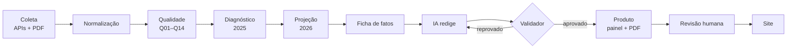

# Briefing Executivo SENAI

Painel e briefing executivo do desempenho do SENAI (Brasil e os 27 Departamentos Regionais), gerado a partir de dados públicos oficiais, com textos de IA que só são publicados depois de checados contra os números e revisados por uma pessoa.

- **App:** https://wiltonbyu-senai-briefing.static.hf.space
- **PDFs executivos:** [Brasil](https://wiltonbyu-senai-briefing.static.hf.space/pdf/Executive_Briefing_SENAI_BR.pdf) · [São Paulo](https://wiltonbyu-senai-briefing.static.hf.space/pdf/Executive_Briefing_SENAI_SP.pdf) · [Alagoas](https://wiltonbyu-senai-briefing.static.hf.space/pdf/Executive_Briefing_SENAI_AL.pdf)

## 1. O problema

Um diretor precisa saber como o Sistema está como um todo, não indicador por indicador.
Os resultados estão públicos, mas espalhados em dezenas de indicadores, 27 regionais e fontes diferentes.
Ninguém deveria precisar lembrar o que é o "indicador 2.1" para entender onde agir.

## 2. A solução

Quatro entregas, a partir das mesmas fontes oficiais:

- **Painel:** visão Brasil, por região e por DR, com a situação de cada indicador e a fonte de cada número.
- **Briefing por IA:** mensagem central, destaques, pontos de atenção e recomendações, em linguagem de gestão.
- **Perguntas verificadas:** seis perguntas típicas de um diretor ("Qual é o principal problema hoje?", "Vamos bater as metas de 2026?", "O que fazer agora?"…), com respostas preparadas e conferidas número a número. O botão **Ver base** mostra os fatos e a fonte de cada número. Não é um chat livre: o catálogo é fechado justamente para que toda resposta seja auditável.
- **PDF executivo:** o mesmo briefing pronto para circular, com a revisão registrada.

## 3. O que os dados mostram

**O Sistema entrega volume, mas o resultado final não acompanha.** Todos os números abaixo vêm da ficha de fatos nacional (`outputs/fatos_BR.json`).

- 23 DRs têm índice de matrículas maior ou igual a 100%; destes, 13 têm índice de empregabilidade abaixo de 80% (F026).
- A correlação entre o índice de matrículas e o de empregabilidade é de -0,26 (26 DRs): mais matrícula não vem acompanhada de mais empregabilidade. Correlação não indica causa (F027).
- No Brasil, a taxa de ocupação de egressos na indústria ficou em 39,8%, para uma meta de 45,0% (índice de 88,4%) (F001). Dos 26 DRs com dado, 14 estão em situação crítica nesse indicador (F013).
- A fidelização de alunos está crítica em 11 dos 27 DRs (F018).
- 10 de 27 DRs têm 4 ou mais indicadores críticos e são candidatos a apoio prioritário do DN (F028).

## 4. Como a IA não inventa números

| Camada | O que faz |
|---|---|
| O código calcula | Todo número é calculado em Python a partir dos dados oficiais. A IA não faz contas. |
| Ficha de fatos | A IA recebe só uma lista de frases prontas, cada uma com um ID (`F001`…) e a fonte de origem. |
| Citação obrigatória | Cada parágrafo do briefing informa os IDs dos fatos que o sustentam. |
| Validador | Confere se cada número e cada sigla de estado do texto aparecem nos fatos citados; bloqueia afirmação de causa que não esteja como hipótese e termos técnicos. |
| Novas tentativas e plano B | Texto reprovado volta à IA com a lista de erros (até 3 vezes). Se não passar, o briefing sai só com as frases dos fatos, sem texto da IA. |
| Revisão humana | Nada é publicado sem o nome de quem revisou (`--revisado-por`). |
| Registro com hash | Cada geração guarda prompt, modelo, respostas, erros e a impressão digital (sha256) dos arquivos usados, em `logs/`. |

Detalhes em [SEGURANCA_IA.md](SEGURANCA_IA.md).

### Prova de que funciona

Cada camada já pegou um problema real nesta edição. O registro completo, com a evidência de cada caso (log ou teste), está em [SEGURANCA_IA.md](SEGURANCA_IA.md#registro-de-verificações).

| O que aconteceu | Quem pegou | O que foi feito |
|---|---|---|
| A fidelização de AL aparecia como 77,2% num fato e 77,3% em outro (arredondamento duplo). | Teste de consistência | Arredondamento único para todo o projeto. |
| Uma resposta de SP trazia um número que não estava nos fatos citados. | Validador automático | Reprovada na 1ª tentativa e refeita; aprovada na 2ª. |
| A fidelização de SP aparecia como 85,4% e 85,5% em fichas diferentes. | **Revisão humana** | Corrigido na origem; o teste de consistência passou a cobrir os 28 escopos e a comparar as fichas entre si. |
| A correção acima mudou medianas nacionais em 0,1 ponto, e o briefing de AL ficou com 2 números desatualizados. | Revalidação antes de publicar | Briefing regerado. A publicação agora é bloqueada se algum texto não bater com a ficha atual. |
| GO publicou 138,1% num indicador que é uma proporção. | Regra de qualidade Q02 | Excluído do farol e sinalizado. |

A lição é a premissa do projeto: nenhuma camada sozinha basta, e por isso são várias.

## 5. Qualidade dos dados

Antes de qualquer análise, 14 regras automáticas (Q01 a Q14) varrem os dados: indicador não apurado, percentual acima de 100, índice publicado diferente do calculado, realizado negativo, realizado sem meta, zero suspeito, índice acima de 200%, entrega não planejada, divergência entre fontes, ano fechado sem realizado, total nacional diferente da soma dos DRs, meta abaixo do que já foi entregue e total diferente da soma das ações.

O princípio é **excluir o inválido, sinalizar o questionável**:
- valor impossível (ex.: um percentual de 138,1%) sai da análise;
- valor duvidoso, mas possível (ex.: índice acima de 200%, que sugere meta baixa demais), fica e é sinalizado;
- campo vazio ou "-" no portal é tratado como ausência de dado, nunca como zero.

**Conferência com o Relatório de Gestão:** 12 de 12 valores nacionais de 2025 conferem com o Relatório de Gestão do DN (F064).

Cada decisão de tratamento está registrada em [DECISOES.md](DECISOES.md).

## 6. Arquitetura



## 7. Como foi construído

A especificação ([SPEC.md](SPEC.md)), as decisões sobre os dados ([DECISOES.md](DECISOES.md)) e a revisão de cada entrega são de **Wilton Costa**.
O código foi escrito com o Claude Code seguindo as regras de [CLAUDE.md](CLAUDE.md): dados brutos intocados, testes para todo módulo novo e nenhuma alteração fora do pedido. Em resumo, desenvolvimento com IA, mas com regras e revisão humana em cada etapa.

## 8. Como rodar

Requer Python 3.12 e, para a geração com IA, uma chave da Anthropic em `.env` (`ANTHROPIC_API_KEY`).

```bash
pip install -r requirements.txt

# Dados e análises
python -m src.coleta --anos 2025 2026 --fontes pes atendimento
python -m src.normaliza
python -m src.qualidade
python -m src.diagnostico
python -m src.projecao
python -m src.fatos --escopo BR

# Texto com IA (use --dry-run para não chamar a API)
python -m src.redator --escopo BR
python -m src.perguntas --escopo BR

# Produto, PDF e publicação
python -m src.produto
python -m src.render_pdf --escopo BR --revisado-por "Nome"
python -m src.publicar --revisado-por "Nome"

# Ver localmente
uvicorn app.main:app
```

**Testes:** 485 testes automatizados (`pytest --collect-only`); rode com `pytest`.

**Estrutura de pastas:**

```
src/        pipeline (coleta, normalização, qualidade, diagnóstico, projeção, fatos, IA, validador, produto, PDF, publicação)
app/        servidor local (FastAPI) e página
prompts/    prompts versionados
tests/      testes (pytest)
data/       raw (bruto, nunca alterado) e processed (tabelas tratadas)
outputs/    fichas de fatos, briefings, dados do app e PDFs
logs/       registro de cada geração com IA
site/       o que vai ao ar (Space estático no Hugging Face)
docs/       protótipo aprovado da interface
```

## 9. Roadmap

- **Edição piloto (atual):** briefing e perguntas verificadas por IA para Brasil, São Paulo e Alagoas; indicadores, farol, mapa e gráficos completos para os 27 DRs.
- **Custo:** cerca de US$ 0,06 por briefing (Claude Sonnet), ou seja, cerca de US$ 3 para gerar briefing e perguntas dos 27 DRs. O visitante não gera custo: o site é estático e só exibe textos já validados.
- **Próximo passo:** geração em lote dos 27 DRs (retoma de onde parou e para se o crédito acabar), mantendo validador, revalidação e revisão humana.
- **Evolução:** atualização trimestral junto com o portal e alerta automático quando um DR mudar de situação.

## 10. Limitações

- 2026 tem dados só até setembro; a projeção é linear (ritmo atual até dezembro) e não considera a sazonalidade do fim do ano.
- Parte dos dados financeiros de 2026 aparece no portal como "R$ - 0", provavelmente ainda não apurada; esses DRs ficam fora da projeção, e isso é dito no briefing.
- Os números descrevem o que aconteceu; relações de causa aparecem sempre como hipótese.
- Só dados públicos: nenhuma informação interna foi usada.

## 11. Fontes oficiais

Portal da Transparência do SENAI (https://sistematransparenciaweb.com.br):
- Plano Estratégico Sistêmico 2025–2027 (API): meta, realizado e índice por DR.
- Atendimento Social (API): matrículas e serviços às empresas, previsto e realizado.
- Relatório de Gestão 2025 do Departamento Nacional (PDF): conferência dos números nacionais.
- Mapa Estratégico 2025–2027 (PDF): estrutura da narrativa.
